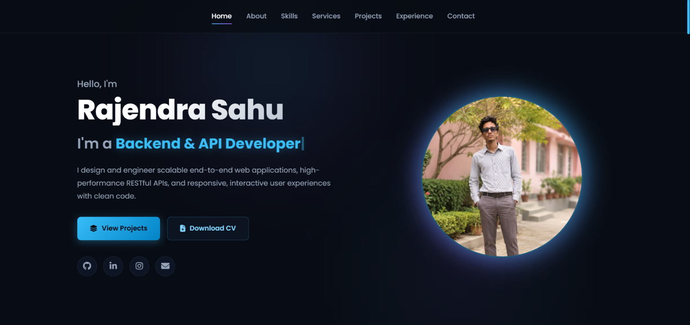

# 🌐 Personal Portfolio

Welcome to my **Personal Portfolio Website** — a modern and responsive website that showcases my skills, projects, education, experience, and contact information.

## 🚀 Live Portfolio

🔗 **Portfolio:** [View Portfolio](https://github.com/rajendrasahu82645-bit/protfolio)

---

## 📌 About the Project

This portfolio website is designed to present my **technical skills, projects, achievements, and professional profile** in a clean and user-friendly interface.

It provides visitors with an easy way to learn about my work and get in touch with me.

---

## ✨ Features

- 🏠 Modern Home / Hero Section
- 👨‍💻 About Me Section
- 🛠️ Skills & Technologies
- 💼 Projects Showcase
- 🎓 Education Section
- 🏆 Achievements / Certifications
- 📄 Resume Section
- 📞 Contact Section
- 📱 Fully Responsive Design
- 🎨 Clean and Modern UI
- ⚡ Fast and Easy Navigation

---

## 🛠️ Technologies Used

- **HTML5**
- **CSS3**
- **JavaScript**
- **Responsive Web Design**
- **Git & GitHub**

---

## 📸 Project Screenshots

### 🏠 Home Page

_Add your portfolio home-page screenshot here._

```markdown
!<>


```

### 👨‍💻 About / Skills

_Add your About or Skills section screenshot here._

```markdown

```

### 💼 Projects Section

_Add your Projects section screenshot here._

```markdown

```

### 📞 Contact Section

_Add your Contact section screenshot here._

```markdown

)
```

---

## 📂 Project Structure

```text
protfolio/
│
├── index.html
├── style.css
├── script.js
├── images/
│   └── ...
├── screenshots/
│   └── ...
└── README.md
```

---

## 🎯 Purpose

The main purpose of this project is to create a professional online presence and showcase my:

- Technical skills
- Academic background
- Projects
- Development experience
- Achievements
- Career interests

---

## 🔮 Future Improvements

- Add dark/light mode
- Add more projects
- Add downloadable resume
- Add animations and interactive effects
- Add backend contact form
- Improve accessibility and performance

---

## 👨‍💻 Developer

**Rajendra Sahu**

💻 Web Developer | Programmer | Tech Enthusiast

---

## ⭐ Support

If you like this portfolio project, consider giving the repository a ⭐ on GitHub.

**Thank you for visiting my portfolio! 🚀**
